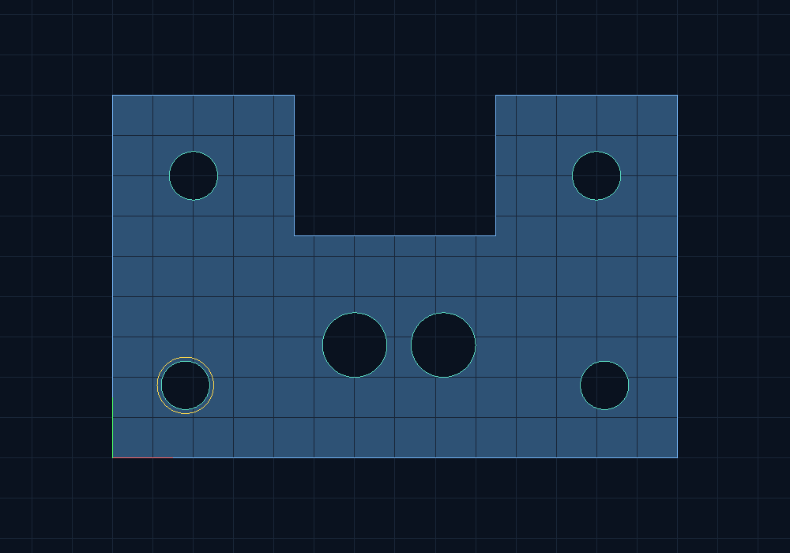

# DXF Fixture Inspector — C++ / OpenGL

A drawing-to-inspection workflow for **concave sheet fixtures with circular cutouts**: import CAD geometry, reject invalid topology, measure manufacturing clearances, inspect a triangulated material domain, edit holes, and export an auditable report plus normalized DXF.



Independent portfolio implementation prepared with AI assistance. Drawings and rates are synthetic; no Nebula or other employer source or customer drawings are included.

## Engineering work in this version

| Problem | Implementation | Evidence |
| --- | --- | --- |
| A bounding rectangle misses collisions with a concave notch | Point-in-polygon, closest segment witness, signed circle-to-boundary clearance | `notch_violation.dxf`: the rectangle passes, the actual boundary fails |
| Unusable CAD input must not become a plausible quote | ASCII DXF tag parser, explicit units, closed-loop and self-intersection validation | Open, crossing, curved and unitless inputs return exit 1 |
| A renderer must show the material geometry | Vertical slab decomposition with even-odd contour parity; circular holes tessellated into rings | Mesh area agrees with the polygonal domain; triangle centroids exclude cutouts |
| Pair checks grow quadratically | Sweep-and-prune broad phase, Y interval rejection, exact circular narrow phase | 200 seeded randomized scenes agree with a brute-force oracle |
| Inspection needs traceable edits | Shared geometry library, analytic picking, cursor-anchored zoom, bounded undo/redo, JSON/CSV/SVG/DXF export | Same analysis supplies CLI and viewport diagnostics |

This remains a **2D** inspection tool. Its original code includes the DXF subset reader, topology and clearance algorithms, material tessellator, report exporter, OpenGL shaders and native window adapters. OpenGL and GLFW provide rendering/platform APIs.

## Build and run

Windows with MinGW GCC installed (the script also accepts `FIXTURE_CXX`):

```powershell
.\run.ps1 -Mode Test
.\build\fixture_viewer.exe --dxf examples/notched_fixture.dxf
.\build\fixture_cli.exe --dxf examples/notch_violation.dxf --out artifacts/notch
```

Linux/WSL with CMake, a C++17 compiler, GLFW and Mesa development packages:

```bash
sudo apt-get install build-essential cmake libglfw3-dev libgl1-mesa-dev
cmake -S . -B build -DCMAKE_BUILD_TYPE=Release
cmake --build build --parallel 2
ctest --test-dir build --output-on-failure
python3 tools/check_reports.py build/fixture_cli
./build/fixture_viewer --dxf examples/notched_fixture.dxf
```

Controls: click a hole; arrows move it 0.5 mm; `Z`/`Y` undo/redo; wheel zooms about the cursor; `WASD` pans; `R` fits; `E` exports the edited geometry and reports to `artifacts/viewer`. `1`/`2`/`3` load introductory scenarios. History retains 100 edits. The title shows the finding count.

CLI exit codes: **0** accepted geometry, **2** manufacturing-rule violations, **1** malformed/unsupported input. Invalid geometry receives no quote. A report contains findings, broad-phase counters, analytic net area/cut length when valid, synthetic line-item costs and `normalized.dxf`. Material cost uses the bounding rectangular stock blank, not net material area.

## CAD contract and algorithms

- One closed, straight-segment `LWPOLYLINE` outer boundary and zero or more `CIRCLE` cutouts.
- `$INSUNITS=4` (mm) or `1` (inch), normalized to mm and a zero-based bounding-box origin. Export uses mm; arbitrary DXF metadata and original entity handles are not retained.
- Bulges, widths, tilted OCS, nonzero elevations, additional outer loops and other entities are rejected. Hole IDs are assigned in import order. Thickness is a separate 2 mm default, not inferred from DXF elevation.
- Nonadjacent segment intersections/touches, collapsed edges and backtracking edges are rejected before analysis. Coordinates/dimensions are bounded to 1e6 mm. Predicates use double precision and a documented fixed tolerance; this is not an exact-predicate CAD kernel.
- Hole clearance uses signed nearest-boundary distance minus radius. Hole-pair clearance uses centre distance minus both radii. Manufacturing thresholds are independent of topological validity.
- Triangulation slices at contour vertex X coordinates, sorts edge intersections in each slab, pairs material intervals by parity, then emits trapezoid triangles. Circle chord error is `r*(1-cos(pi/N))`; analytic metrics retain true circles. Meshes are cached until the geometry revision changes. Overlapping/outside/tangent cutouts remain visible as diagnostic outlines, without a material fill.
- Topology checks and tessellation can be quadratic. The viewport has an 8192-contour-vertex / 256-hole budget. The CLI supports 10000 imported circles; sweep-and-prune can still degrade to O(n²) on dense inputs.

## Reproducible evidence

`fixture_cad_tests` writes `artifacts/cad_benchmark.json`. A local GCC 16.2 Release-style run analyzed a sparse 10000-hole drawing with **49,995,000 possible pairs, 0 exact pair-distance evaluations, approximately 4.12 ms**. This is one measured sparse workload, not a general latency guarantee. Candidate filtering still performs interval comparisons. See [the saved result](docs/evidence/cad_benchmark.json).

Tests include analytic areas/perimeters, invalid CAD, inch conversion, DXF round-trip, winding invariance, mesh-area agreement, hole exclusion, viewport round-trip and a 200-scene differential oracle. CI builds on Linux and Windows and captures a real OpenGL frame through Mesa/Xvfb.

- [Chinese engineering walkthrough and exercises](docs/ENGINEERING_CN.md)
- [Introductory C++ / OpenGL lessons](docs/LEARN_CN.md)
- [Validation record](docs/VALIDATION.md)
- [Dependencies and upstream references](THIRD_PARTY.md)

MIT license. This tool does not implement nesting, toolpath generation, 3D solids or an industrial quoting model.
