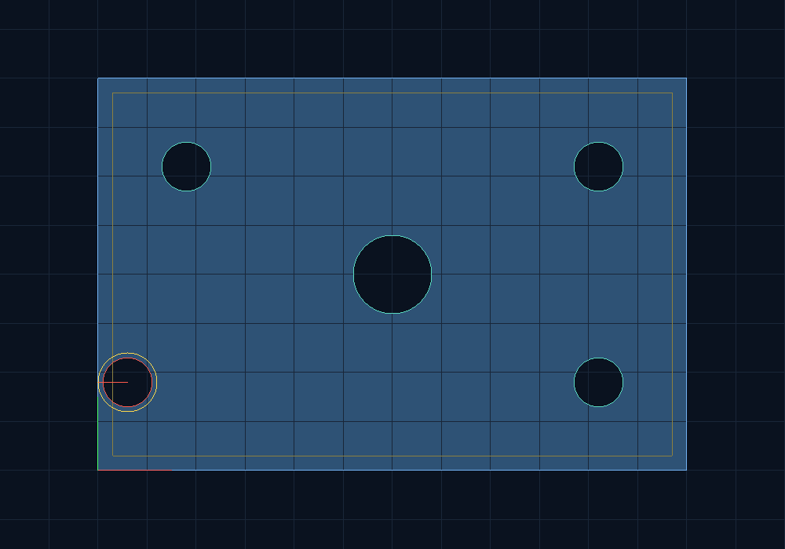

# Fixture Graphics Lab

A **C++17 / OpenGL 3.3** engineering portfolio: review a parameterized plate, find hole-clearance problems, edit geometry interactively, and export reproducible reports with a synthetic cost breakdown.



The image above is captured from the native OpenGL application. Red outlines identify rule violations; teal outlines identify passing holes; yellow marks the selection and the inset rule guide.

This is an independent portfolio implementation prepared with AI assistance. It contains no Nebula source code, customer CAD, supplier pricing, or production fixtures. It demonstrates a bounded engineering workflow rather than claiming a production CAD kernel.

## Implemented capabilities

| Area | Evidence |
| --- | --- |
| Modern C++ | Typed data model, standard containers, const references, exceptions, a testable core and RAII GPU/window ownership |
| Geometry | Analytical circle-to-edge and circle-to-circle clearance; negative clearance identifies overlap/outside geometry |
| Graphics | OpenGL 3.3 core context, GLSL vertex/fragment shaders, VAO/VBO, interleaved vertex attributes and orthographic matrix |
| Interaction | World/screen coordinate transforms, analytic hole picking, cursor-anchored zoom, pan and dimension editing |
| Engineering workflow | Input validation, explicit mm units, pass/fail diagnostics, JSON/CSV/SVG export and itemized synthetic quote |
| Verification | Geometry and transform checks, CLI/export integration tests, deterministic OpenGL screenshot mode and CI |

## Run on Windows

From PowerShell in this repository:

```powershell
.\run.ps1 -Mode Test
.\run.ps1 -Mode Demo
```

The script uses `C:\msys64\ucrt64\bin\g++.exe` when available; otherwise it looks for `g++` on PATH. Set `FIXTURE_CXX` to select another MinGW GCC compiler. The Windows viewer uses native Win32/WGL and requires a driver supporting OpenGL 3.3; no GLFW or Qt download is needed.

## Run on Ubuntu / WSL

```bash
sudo apt-get update
sudo apt-get install -y build-essential cmake libglfw3-dev libgl1-mesa-dev
cmake -S . -B build -DCMAKE_BUILD_TYPE=Release
cmake --build build --parallel 2
ctest --test-dir build --output-on-failure
python3 tools/check_reports.py build/fixture_cli
./build/fixture_viewer
```

For a machine without a desktop display:

```bash
sudo apt-get install -y xvfb
xvfb-run -a env LIBGL_ALWAYS_SOFTWARE=1 ./build/fixture_viewer --example 2 --capture artifacts/opengl.ppm
```

Core and CLI can be built without OpenGL dependencies using `-DFIXTURE_BUILD_VIEWER=OFF`.

## Viewer controls

| Control | Action |
| --- | --- |
| `1`, `2`, `3` | Nominal, edge-clearance failure, overlap failure |
| Left click a hole | Select it |
| Arrow keys | Move selected hole by 0.5 mm |
| Mouse wheel | Zoom around pointer |
| `W A S D` | Pan |
| `R` | Reset view |
| `E` | Export current scene reports into `artifacts/viewer` |
| Escape | Close |

The window title shows finding count and selection. Press `2`, then press the right arrow four times: the first hole moves from x=6 to x=8 mm, and its clearance rises from 1 to the required 3 mm.

## Headless engineering check

```bash
./build/fixture_cli --scene examples/nominal.scene --quantity 10 --out artifacts/nominal
./build/fixture_cli --scene examples/edge_failure.scene --out artifacts/edge
```

Outputs are `report.json`, `findings.csv`, and `preview.svg`. Exit codes: `0` passes, `2` reports geometry-rule violations, `1` indicates invalid input or execution error. A scene with geometry findings receives a null quote.

The quote uses demonstration rates: rectangular blank material area, total boundary cutting length, quantity and one setup charge. It is not a commercial quote, machining simulation or manufacturing approval.

## Code map

```text
include/fixture/geometry.hpp    public geometry and view API
src/geometry.cpp               constraints, metrics, quoting, parser and exports
src/viewer.cpp                 OpenGL pipeline and interactive scene
src/window_win32.cpp           Windows WGL context and input
src/window_glfw.cpp            Linux GLFW context and input
tests/test_geometry.cpp        mathematical and behavioral checks
tools/check_reports.py         real CLI/export integration checks
```

- [Chinese first lesson and learning path](docs/LEARN_CN.md)
- [Architecture and interview questions](docs/INTERVIEW_CN.md)
- [Validation record](docs/VALIDATION.md)
- [References and scope](THIRD_PARTY.md)

## Scope

The supported geometry is a rectangular plate with circular holes. Analytic checks use exact circle formulas; the viewer tessellates circles into 96 segments. Hole disks are overdrawn in the background color, not subtracted by a solid-modeling kernel. No STEP/DXF import, nesting optimizer, CAD topology, 3D lighting, machining toolpaths or production pricing engine is implemented.

Original project code is MIT licensed.
